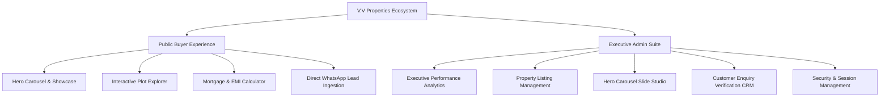

<div align="center">

  

  # V.V PROPERTIES
  ### Enterprise Luxury Real Estate Platform & Executive Management Suite

  [](https://nextjs.org/)
  [](https://www.typescriptlang.org/)
  [](https://tailwindcss.com/)
  [](https://www.framer.com/motion/)
  [](LICENSE)

  <p align="center">
    <b>A high-performance, full-stack real estate enterprise solution delivering ultra-luxury residential showcases, plot exploration engines, instant WhatsApp lead conversion, and an executive administration suite.</b>
  </p>

  [Live Portal Demo](http://localhost:3000) • [Architecture Guide](#-system-architecture) • [Quickstart](#-quickstart--local-development) • [Deployment](#-production-deployment)

</div>

---

## 🌟 Executive Overview

**V.V Properties** is an enterprise-grade digital real estate platform engineered for high-value residential, villa, gated community, and commercial property portfolios across Chennai and South India. Built upon **Next.js 14 App Router**, **TypeScript**, and **Tailwind CSS**, the platform bridges high-fidelity buyer experiences with a centralized, data-driven administrative command center.

---

## 🏛️ Core Platform Modules



### 1. 🏡 Public Property Discovery & Client Experience
* **Image-First Property Architecture**: Sleek luxury cards featuring clean aspect ratios, glassmorphism badges, and smooth gradient specification overlays revealing pricing, configuration, location, and key amenities.
* **Smart Filter & Search**: Multi-dimensional filtering by location (OMR, ECR, Tambaram, etc.), property type (Apartments, Villas, Plots), and tags (*Featured*, *New Launch*, *Special Offer*).
* **Direct WhatsApp Integration**: Zero-friction client communication pathways enabling immediate scheduling of weekend site visits with pre-configured listing metadata.
* **Interactive Financial Tools**: Client-side EMI and amortization calculators built with precision formula modeling.

### 2. ⚡ Executive Admin Portal (`/admin`)
* **Real-Time Performance Velocity**: Dynamic SVG vector analytics mapping weekly, monthly, quarterly, and annual customer acquisition velocity across acquisition channels.
* **Listing Management Engine**: Full CRUD lifecycle operations (Add, Edit, Quick-Rename, and Archive/Delete) with autofill-protected form security and vertical 3-dots context menus.
* **Hero Carousel Studio**: Manage up to 10 homepage slides with real-time capacity monitoring (*5 active slides maximum* for optimal SEO and LCP rendering metrics).
* **Priority Lead Management (Mini-CRM)**: Slide-over enquiry verification drawer with client communication histories, status tracking (*New*, *Contacted*, *Closed*), and one-click contact copying.

---

## 🛠️ Technology Stack

| Layer | Technologies | Purpose |
|---|---|---|
| **Framework** | Next.js 14 (App Router), React 18 | High-throughput SSR/SSG rendering, Edge API routes |
| **Language** | TypeScript 5.6 (Strict Mode) | End-to-end type safety and compile-time contract enforcement |
| **Styling** | Tailwind CSS 3.4, PostCSS, Autoprefixer | Custom design tokens, luxury utility classes, modern layout engine |
| **Typography** | Outfit, Plus Jakarta Sans | High-contrast geometric headings & refined editorial body copy |
| **Animations** | Framer Motion 11, GSAP 3, Lenis Scroll | 60 FPS fluid micro-interactions, spring physics, smooth momentum scrolling |
| **Icons & UI** | Lucide Icons, Canvas Confetti | Sharp SVG vector iconography and celebration feedback |
| **Security** | Web Crypto API, HMAC-SHA256, HTTP-Only Cookies | Tamper-proof admin session authentication |

---

## 📁 Repository Directory Structure

```text
v.v-properties/
├── public/
│   ├── brand/               # Brand vectors and typography guidelines
│   ├── images/              # High-definition architectural assets
│   ├── admin.html           # Standalone Executive Admin Portal build
│   └── logo.png             # Official V.V Properties Emblem
├── src/
│   ├── app/
│   │   ├── (public)/        # Buyer-facing landing, listings & calculators
│   │   ├── admin/           # Next.js protected admin dashboard routes
│   │   │   ├── login/       # High-security credential authentication
│   │   │   └── page.tsx     # Full-featured enterprise admin console
│   │   ├── api/             # Secure REST endpoints (leads, plots, settings)
│   │   ├── layout.tsx       # Root layout with metadata & font injections
│   │   └── globals.css      # Core Tailwind layers & custom animations
│   ├── components/          # Atomic UI components, cards, navigation, drawers
│   ├── config/              # Central site constants, contact hotlines & SEO metadata
│   ├── data/                # Initial curated property matrices and plot data
│   ├── lib/                 # Store management, crypto utilities, validators
│   └── types/               # Comprehensive TypeScript definitions
├── admin-portal.html        # Root mirror of executive portal
├── package.json             # Application dependencies and execution scripts
├── tailwind.config.ts       # Tailored color palettes (Brand Azure, Obsidian Navy)
├── tsconfig.json            # TypeScript configuration
└── DEPLOYMENT.md            # Comprehensive production deployment handbook
```

---

## 🚀 Quickstart & Local Development

### Prerequisites
* **Node.js**: `v18.18.0` or higher (Node 20 LTS recommended)
* **npm**: `v9.0.0` or higher

### 1. Clone the Repository
```bash
git clone https://github.com/sharmikamurugesan-1/v.v-properties.git
cd v.v-properties
```

### 2. Install Dependencies
```bash
npm install
```

### 3. Environment Configuration
Create an environment file by copying the template:
```bash
cp .env.example .env.local
```
Configure your credentials in `.env.local`:
```env
ADMIN_PASSWORD=your_secure_admin_password_here
ADMIN_SESSION_SECRET=your_32_character_random_hex_secret_here
NEXT_PUBLIC_WHATSAPP_NUMBER=919876543210
NEXT_PUBLIC_SITE_URL=https://vvpropertiescbe.com
```

### 4. Run Development Server
```bash
npm run dev
```
Open **[http://localhost:3000](http://localhost:3000)** in your browser to view the application.

---

## 🔐 Environment Variables Specification

| Variable | Requirement | Description | Default / Example |
|---|---|---|---|
| `ADMIN_PASSWORD` | **Required** | Secret key for `/admin` management portal authentication | High-entropy string (16+ chars) |
| `ADMIN_SESSION_SECRET` | **Required** | HMAC-SHA256 signature key for 8-hour admin session tokens | 32+ character random hex string |
| `NEXT_PUBLIC_WHATSAPP_NUMBER`| Optional | Primary client WhatsApp hotline with country code | `919876543210` |
| `LEAD_WEBHOOK_URL` | Optional | Outbound webhook endpoint for CRM integration (Zoho/Zapier) | `https://hooks.zapier.com/...` |
| `NEXT_PUBLIC_SITE_URL` | Optional | Canonical URL for SEO indexing and OpenGraph cards | `https://vvpropertiescbe.com` |
| `NEXT_PUBLIC_GA_ID` | Optional | Google Analytics 4 Measurement ID (gated by cookie consent)| `G-XXXXXXXXXX` |

---

## 🚢 Production Deployment

### Deploy to Vercel (Recommended)
1. Fork or import this repository into your [Vercel Dashboard](https://vercel.com).
2. Ensure the framework preset is set to **Next.js**.
3. Add the required environment variables (`ADMIN_PASSWORD`, `ADMIN_SESSION_SECRET`).
4. Trigger the deployment. Production builds deploy automatically upon pushes to `main`.

### Standalone Production Build
```bash
npm run build
npm run start
```

---

## 🛡️ Quality & Verification Scripts

```bash
# Type check without emitting files
npx tsc --noEmit

# Run ESLint validation
npm run lint

# Content integrity check
npm run check:content
```

---

## 📄 License & Intellectual Property

Copyright © 2026 **V.V Properties**. All rights reserved.  
All architectural designs, photography, portal software, and brand trademarks are proprietary assets.

---

<div align="center">
  <sub>Crafted for modern enterprise real estate excellence · Powered by Next.js & Tailwind CSS</sub>
</div>
